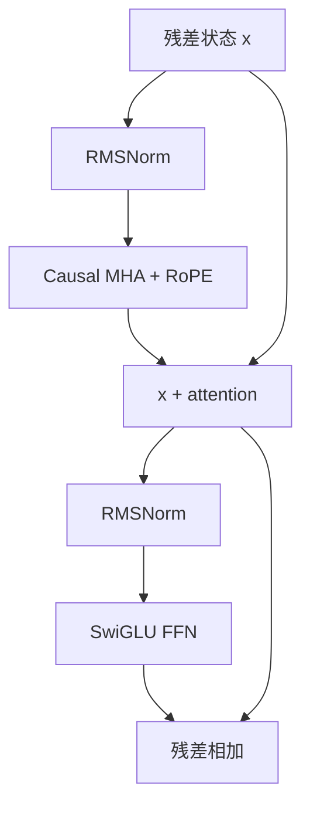

## 1. Decoder-only Transformer

### 1.1 语言模型的输入与输出

设：

- batch size 为 $B$；
- 序列长度为 $S$；
- 模型维度为 $d_{\text{model}}$；
- 词表大小为 $V$；
- Transformer 层数为 $L$。

输入 token id：

$$
T \in \{0,\ldots,V-1\}^{B\times S}.
$$

通过 token embedding 得到初始隐藏状态：

$$
X^{(0)} = E[T]
\in \mathbb{R}^{B\times S\times d_{\text{model}}},
$$

其中 embedding 矩阵：

$$
E\in\mathbb{R}^{V\times d_{\text{model}}}.
$$

经过 $L$ 个 Transformer block 和最终归一化后，语言模型头（LM head）把每个位置映射到词表 logits：

$$
\text{logits}
=
X^{(L)}W_{\text{vocab}}
\in
\mathbb{R}^{B\times S\times V}.
$$

对每个位置做 softmax，得到下一个 token 的概率分布。训练时，第 $i$ 个位置的输出应预测输入中的第 $i+1$ 个 token。

### 1.2 一个现代 pre-norm block

Pre-norm block 的结构可以写为：

$$
Z^{(\ell)}
=
X^{(\ell)}
+
\operatorname{MHA}\!\left(
\operatorname{RMSNorm}(X^{(\ell)})
\right),
$$

$$
X^{(\ell+1)}
=
Z^{(\ell)}
+
\operatorname{FFN}\!\left(
\operatorname{RMSNorm}(Z^{(\ell)})
\right).
$$



这里有两条不同的数据路径：

- **残差主干（residual stream）**：隐藏状态通过加法一路向前传递；
- **残差分支**：先归一化，再经过 attention 或 FFN，最后加回主干。

attention 负责让不同位置之间交换信息；FFN 负责对每个位置的特征做非线性变换。两者解决的问题不同，所以标准 block 通常串行执行二者。

### 1.3 为什么残差连接如此重要？

最小残差模块为：

$$
y=x+F(x).
$$

其梯度包含一条恒等路径：

$$
\frac{\partial y}{\partial x}
=
I+
\frac{\partial F(x)}{\partial x}.
$$

即使 $F$ 分支的梯度很小，梯度仍可通过 $I$ 直接传播。深层网络依靠这条“高速公路”降低梯度消失和优化困难。

> 不是完全不处理隐藏状态，而是避免在残差主干上反复放置会改变尺度和方向的非恒等变换。pre-norm 把归一化放到分支入口，使主干仍然保留直接的加法路径。

## 2. 归一化及其位置

### 2.1 归一化在解决什么问题？

随着网络变深，隐藏状态和 attention logits 的尺度可能不断漂移。尺度过大可能导致：

- softmax 过度饱和；
- 梯度出现尖峰（spike）或爆炸；
- 不同层的更新尺度差异很大；
- 对学习率和 warmup 更敏感。

归一化通过控制向量尺度，让不同层接收到更可预测的数值范围。但**归一化放在哪里**会直接决定残差主干是否仍是恒等路径。

### 2.2 Post-norm 与 pre-norm

为简化符号，令 $F$ 表示 attention 或 FFN 子层。

#### Post-norm

原始 Transformer 使用：

$$
y
=
\operatorname{Norm}\!\left(x+F(x)\right).
$$

归一化位于残差加法之后，因此主干也必须经过 Norm。深层网络中，这会让梯度连续穿过许多归一化层，优化通常更敏感。

#### Pre-norm

现代语言模型更常见：

$$
y
=
x+F\!\left(\operatorname{Norm}(x)\right).
$$

残差主干保留 $x\rightarrow y$ 的直接路径；Norm 只作用于送入 $F$ 的分支。这通常带来：

- 更顺畅的梯度传播；
- 更少的训练 spike；
- 对深度和较大学习率更稳健；
- 减少对精细 warmup 的依赖，但不意味着 warmup 一定可以删除。

| 对比 | Pre-norm | Post-norm |
|---|---|---|
| 形式 | $x+F(\operatorname{Norm}(x))$ | $\operatorname{Norm}(x+F(x))$ |
| 残差恒等路径 | 保留 | 被 Norm 改变 |
| 深层训练 | 通常更稳定 | 通常更敏感 |
| 现代 LLM | 主流默认 | 较少见 |
| 是否绝对更好 | 否，最终效果依任务与配方而定 | 否，但训练难度通常更高 |

> pre-norm 的主要优势是**优化稳定性**，不能直接推出它在所有设置下最终验证损失都更低。比较两者时，学习率和 warmup 可能都需要重新调节。

### 2.3 Non-residual post-norm / double norm

一些模型在保留 pre-norm 的同时，又在 attention 或 FFN 分支输出处增加 Norm，再与残差主干相加：

$$
y
=
x+
\operatorname{Norm}_{\text{post}}\!\left(
F(\operatorname{Norm}_{\text{pre}}(x))
\right).
$$

它与传统 post-norm 的区别是，后置 Norm 仍然在残差分支上，不阻断主干恒等路径。这是一种额外稳定化方案，不是所有模型都需要的默认配置。

### 2.4 LayerNorm 的概念与公式

LayerNorm 对每个 token 的隐藏向量独立归一化。给定：

$$
x=(x_1,\ldots,x_d),
\qquad d=d_{\text{model}},
$$

均值和方差为：

$$
\mu
=
\frac{1}{d}\sum_{i=1}^{d}x_i,
$$

$$
\sigma^2
=
\frac{1}{d}\sum_{i=1}^{d}(x_i-\mu)^2.
$$

LayerNorm：

$$
\operatorname{LayerNorm}(x)_i
=
\gamma_i
\frac{x_i-\mu}{\sqrt{\sigma^2+\epsilon}}
+\beta_i.
$$

- $\gamma$：可学习缩放参数；
- $\beta$：可学习平移参数；
- $\epsilon$：避免分母接近 0；
- 归一化只沿最后的 $d_{\text{model}}$ 维进行，不跨 batch 和 sequence 维。

### 2.5 RMSNorm 的概念与公式

RMSNorm 不减去均值，而是用均方根（root mean square）控制向量尺度：

$$
\operatorname{RMS}(x)
=
\sqrt{
\frac{1}{d}\sum_{i=1}^{d}x_i^2
+\epsilon
},
$$

$$
\operatorname{RMSNorm}(x)_i
=
\gamma_i
\frac{x_i}{\operatorname{RMS}(x)}.
$$

| 对比 | LayerNorm | RMSNorm |
|---|---|---|
| 是否减均值 | 是 | 否 |
| 归一化量 | 中心化后的方差 | 原始二阶矩的均方根 |
| 常见可学习参数 | $\gamma,\beta$ | $\gamma$ |
| 主要收益 | 成熟、稳定 | 操作更少、数据移动更少 |
| 现代 LLM 使用情况 | 仍有使用 | 更常见的默认选择 |

> RMSNorm 不是“只归一化方差”。方差要求先减均值，而 RMSNorm 使用的是 $\frac{1}{d}\sum_i x_i^2$，即未中心化的二阶矩。

### 2.6 为什么少量 FLOPs 也可能影响 wall-clock time？

矩阵乘法占 Transformer 的大多数 FLOPs，但 Norm 往往需要：

1. 从显存读取整个激活向量；
2. 做 reduction 求均值或均方；
3. 再逐元素缩放；
4. 写回输出。

它的 FLOPs 很少，却可能受内存带宽、kernel launch 和 reduction 同步限制。因此：

> **FLOPs 少，不等于运行时间可以忽略。**

RMSNorm 少一次均值计算、中心化和 bias 数据访问，实际收益更多来自更简单的数据流，而不是参数量少了多少。

### 2.7 为什么现代模型常移除 bias？

很多现代 Transformer 的线性层和 Norm 不使用 bias。可能的考虑包括：

- bias 对整体表达能力的增益通常有限；
- 需要额外读取、广播和更新参数；
- 简化 kernel 和参数状态；
- 在部分训练配方中有利于数值稳定。

但这是一项经验设计，不是“有 bias 就错误”。小模型、特定任务或已有架构仍可能保留 bias。

## 3. FFN 与激活函数：每个 token 内部的非线性计算

### 3.1 FFN 在做什么？

attention 让 token 之间交换信息；位置前馈网络（position-wise FFN）则对每个 token 独立应用同一组参数：

$$
\operatorname{FFN}(X)_{b,s,:}
=
f(X_{b,s,:}).
$$

所以 FFN 不混合 sequence 位置，只混合隐藏维度。

标准两层 FFN：

$$
\operatorname{FFN}(x)
=
\phi(xW_1)W_2,
$$

其中：

$$
W_1\in\mathbb{R}^{d_{\text{model}}\times d_{\text{ff}}},
\qquad
W_2\in\mathbb{R}^{d_{\text{ff}}\times d_{\text{model}}}.
$$

shape 流程：

$$
(B,S,d_{\text{model}})
\rightarrow
(B,S,d_{\text{ff}})
\rightarrow
(B,S,d_{\text{model}}).
$$

### 3.2 常见激活函数

#### ReLU

$$
\operatorname{ReLU}(x)=\max(0,x).
$$

优点是简单、便宜；负半轴梯度为 0，表达较硬。

#### GELU

$$
\operatorname{GELU}(x)=x\Phi(x),
$$

其中 $\Phi(x)$ 是标准正态分布的累积分布函数。GELU 是平滑门控，在 GPT 系列等模型中长期使用。

#### SiLU / Swish

$$
\operatorname{SiLU}(x)
=
x\sigma(x),
$$

其中 $\sigma(x)$ 是 sigmoid。`SiLU` 与参数 $\beta=1$ 的 Swish 通常指同一函数。

### 3.3 什么是门控线性单元（GLU）？

门控的直觉是：一条分支产生候选特征，另一条分支学习每个维度应放行多少，然后逐元素相乘。

一般形式：

$$
\operatorname{GLU}_{\phi}(x)
=
\phi(xW_1)\odot(xW_3),
$$

再投影回模型维度：

$$
\operatorname{FFN}_{\text{gated}}(x)
=
\left[
\phi(xW_1)\odot(xW_3)
\right]W_2.
$$

- $\odot$：逐元素乘法；
- ReGLU：$\phi=\operatorname{ReLU}$；
- GeGLU：$\phi=\operatorname{GELU}$；
- SwiGLU：$\phi=\operatorname{SiLU}$。

SwiGLU 的常见写法：

$$
\operatorname{SwiGLU}(x)
=
\left[
\operatorname{SiLU}(xW_1)
\odot
(xW_3)
\right]W_2.
$$

对应 shape：

```text
x                  (B, S, d_model)
x @ W1             (B, S, d_ff)
x @ W3             (B, S, d_ff)
SiLU(.) ⊙ (.)      (B, S, d_ff)
... @ W2           (B, S, d_model)
```

### 3.4 为什么 gated FFN 要缩小 d_ff？

忽略 bias：

普通 FFN 参数量为：

$$
N_{\text{FFN}}
=
2d_{\text{model}}d_{\text{ff}}.
$$

若采用传统比例 $d_{\text{ff}}=4d_{\text{model}}$：

$$
N_{\text{FFN}}
=
8d_{\text{model}}^2.
$$

SwiGLU 有 $W_1,W_2,W_3$ 三个矩阵：

$$
N_{\text{SwiGLU}}
=
3d_{\text{model}}d_{\text{ff}}.
$$

为了与普通 4 倍 FFN 近似匹配参数量，令：

$$
3d_{\text{model}}d_{\text{ff}}
=
8d_{\text{model}}^2,
$$

可得：

$$
d_{\text{ff}}
=
\frac{8}{3}d_{\text{model}}
\approx
2.67d_{\text{model}}.
$$

> 比较 SwiGLU 与非门控激活时，必须大致匹配参数量或计算量。若两边都直接使用相同 $d_{\text{ff}}$，SwiGLU 多出一个大矩阵，实验无法说明性能增益来自“门控”还是“模型更大”。

### 3.5 Serial 与 parallel block

标准串行结构：

$$
z=x+\operatorname{Attention}(\operatorname{Norm}(x)),
$$

$$
y=z+\operatorname{FFN}(\operatorname{Norm}(z)).
$$

并行结构让 attention 和 FFN 读取相同输入：

$$
y
=
x
+\operatorname{Attention}(\operatorname{Norm}(x))
+\operatorname{FFN}(\operatorname{Norm}(x)).
$$

并行结构可能共享 Norm、融合部分矩阵乘法并缩短依赖链，但也减少了一个 block 内 attention 与 FFN 的串行变换深度。少数模型使用，主流仍是 serial。

## 4. 位置编码：让 attention 知道顺序与距离

### 4.1 为什么需要位置信息？

若没有位置机制，self-attention 主要根据 token 内容计算关系，本身不能稳定区分“谁在前、谁在后、相距多远”。causal mask 能告诉模型哪些位置可见，但不直接提供精细的距离表示。

位置编码方案可按“位置信息注入哪里”分类：

| 方案 | 注入位置 | 是否可学习 | 主要特点 |
|---|---|---:|---|
| 正弦位置编码 | 与 token embedding 相加 | 否 | 固定、多频率 |
| 学习式绝对位置 embedding | 与 token embedding 相加 | 是 | 简单，但位置表有固定范围 |
| 相对位置 bias / embedding | attention score 内 | 可选 | 直接描述相对距离 |
| RoPE | 旋转 query 和 key | 否（通常） | 点积自然依赖相对位置 |

### 4.2 正弦位置编码

原始 Transformer 使用固定的正弦与余弦：

$$
PE_{(p,2i)}
=
\sin\left(
\frac{p}{10000^{2i/d_{\text{model}}}}
\right),
$$

$$
PE_{(p,2i+1)}
=
\cos\left(
\frac{p}{10000^{2i/d_{\text{model}}}}
\right).
$$

然后：

$$
X_{p}=E[t_p]+PE_p.
$$

不同维度使用不同频率，模型可以组合这些周期信号推断位置关系。缺点是位置和内容在进入 attention 前直接相加，会产生内容—位置交叉项。

### 4.3 学习式绝对位置 embedding

为每个位置学习一个向量：

$$
X_p=E[t_p]+P_p,
\qquad
P\in\mathbb{R}^{S_{\max}\times d_{\text{model}}}.
$$

它简单有效，但位置表通常只覆盖预设的 $S_{\max}$；超过训练长度时没有自然定义，需要插值、扩展或重新训练。

### 4.4 相对位置编码

相对位置方法把距离 $i-j$ 直接加入 attention。例如使用相对 bias：

$$
s_{ij}
=
\frac{q_i k_j^\top}{\sqrt{d_h}}
+b_{i-j}.
$$

它显式建模 token 间距离，而不是给每个位置分配一个完全独立的身份。

> 相对形式减少了对绝对位置表的依赖，但能否泛化到更长上下文仍取决于距离参数化、训练长度、频率设置、attention 模式和缩放方法。不能仅凭“相对”二字保证外推效果。

### 4.5 RoPE 的目标

RoPE（Rotary Position Embedding）希望对位置 $m$ 的向量施加变换 $R_m$，使 query 与 key 点积只通过相对位置 $n-m$ 感知距离：

$$
\left\langle R_m q, R_n k\right\rangle
=
q^\top R_m^\top R_n k
=
q^\top R_{n-m}k.
$$

关键性质是二维旋转矩阵满足：

$$
R_m^\top R_n=R_{n-m}.
$$

因此，虽然每个向量按照自己的绝对位置旋转，二者点积中的旋转差只依赖相对位置。

### 4.6 RoPE 的二维旋转

把 head 维度两两配对。对于第 $r$ 对坐标，位置 $p$ 对应角度：

$$
\theta_{p,r}
=
p\cdot\Theta^{-2r/d_h},
$$

其中 $\Theta$ 是 RoPE base；例如取 $10000$，可得到一组不同频率的旋转。

对二维向量 $(x_{2r},x_{2r+1})$：

$$
\begin{bmatrix}
x'_{2r}\\
x'_{2r+1}
\end{bmatrix}
=
\begin{bmatrix}
\cos\theta_{p,r} & -\sin\theta_{p,r}\\
\sin\theta_{p,r} & \cos\theta_{p,r}
\end{bmatrix}
\begin{bmatrix}
x_{2r}\\
x_{2r+1}
\end{bmatrix}.
$$

展开为：

$$
x'_{2r}
=
x_{2r}\cos\theta_{p,r}
-x_{2r+1}\sin\theta_{p,r},
$$

$$
x'_{2r+1}
=
x_{2r}\sin\theta_{p,r}
+x_{2r+1}\cos\theta_{p,r}.
$$

### 4.7 RoPE 应用于哪些张量？

RoPE 作用于每一层 attention 的 **query 和 key**，不作用于 value：

$$
Q'=\operatorname{RoPE}(Q),
\qquad
K'=\operatorname{RoPE}(K),
$$

$$
\operatorname{Attention}(Q,K,V)
=
\operatorname{softmax}\left(
\frac{Q'K'^\top}{\sqrt{d_h}}+M
\right)V.
$$

在每个 head 上独立执行相同的位置旋转。常见 shape：

$$
Q,K,V
\in
\mathbb{R}^{B\times H\times S\times d_h}.
$$

实现时通常预计算：

$$
\cos\theta,
\sin\theta
\in
\mathbb{R}^{S_{\max}\times d_h/2},
$$

并注册为 buffer，避免每层、每次前向重复计算。位置 id 可以带任意前导 batch 维，因此广播逻辑和最后一维配对是常见 bug 来源。

### 4.8 RoPE 与正弦位置编码的核心差异

- 正弦编码：把位置向量**加到输入 embedding**；
- RoPE：用正弦、余弦对 $Q/K$ 做**乘法旋转**；
- 正弦相加会引入内容—位置交叉项；
- RoPE 利用旋转的组合性质，让点积中的位置依赖呈相对形式。

> 超过训练长度后，频率分布和 attention 行为仍可能失真。实际长上下文模型经常需要调整 RoPE base 或采用位置缩放方法，并重新验证质量。

## 5. 超参数与常见比例

### 5.1 d_ff 与 d_model

传统非门控 FFN 的常见默认值：

$$
d_{\text{ff}}
\approx
4d_{\text{model}}.
$$

参数量匹配的 SwiGLU 常采用：

$$
d_{\text{ff}}
\approx
\frac{8}{3}d_{\text{model}}.
$$

这不是数学定律。课程材料展示的模型调查说明，$d_{\text{ff}}/d_{\text{model}}$ 在较宽范围内都可能工作；$4$ 和 $8/3$ 是稳定、常见、便于比较的起点。

工程实现还常把 $d_{\text{ff}}$ 向某个倍数取整，例如 64 或 256，以适配 Tensor Core 和矩阵布局。

### 5.2 head 数、head 维度与模型维度

标准 MHA 常设置：

$$
d_{\text{model}}
=
H_q d_h.
$$

于是 $Q/K/V$ 投影后只需 reshape：

$$
(B,S,d_{\text{model}})
\rightarrow
(B,H_q,S,d_h).
$$

但这不是理论限制。一般可令 query 投影输出维度为 $H_qd_h$，再用输出矩阵映射回 $d_{\text{model}}$：

$$
W_Q
\in
\mathbb{R}^{d_{\text{model}}\times H_qd_h}.
$$

因此 $H_qd_h/d_{\text{model}}$ 可以不等于 1。只是比例为 1 的设计最简单、最常见，也方便高效实现。

> $H_qd_h=d_{\text{model}}$ 不是“经验上大约成立”的模糊关系：在很多标准实现中它是明确的架构约束；在更一般的投影设计中则可以不成立。需要查看具体实现，而不是只看术语“multi-head”。

### 5.3 模型宽高比（aspect ratio）

这里使用：

$$
\text{aspect ratio}
=
\frac{d_{\text{model}}}{L}.
$$

对许多经典大模型，课程材料观察到约 $100$–$200$ 是常见区间，但也有明显例外。这是模型调查所得的经验带，不是普适最优值。

过深、过窄的模型可能：

- 串行依赖更长，训练并行度更差；
- 推理延迟更高，因为每个 token 必须依次经过更多层；
- 梯度传播和数值稳定更困难。

过宽、过浅也可能降低表达效率或让单层矩阵过大。最终需要在效果、设备并行方式、延迟和参数预算之间平衡。

### 5.4 词表大小

原始材料中的粗略经验：

- 单语模型常见约 $30$k–$50$k；
- 多语种或生产系统常见约 $100$k–$250$k。

词表变大的收益：

- 常见词和多语言字符可用更少 token 表示；
- 序列更短，attention 和训练步中的 token 数减少；
- 对代码、数字、多语言可能更友好。

代价：

- embedding 参数量约为 $Vd_{\text{model}}$；
- 若 LM head 不共享权重，还需另一个 $d_{\text{model}}V$ 矩阵；
- 每个 token 计算 logits 的成本随 $V$ 增长；
- 更大词表中的低频 token 可能训练不足。

因此词表大小同时是 tokenizer、模型参数和系统效率问题，不能只看“每段文本 token 更少”。

### 5.5 Dropout 与 weight decay

大规模预训练常使用极大量、近似单遍的数据，因此经典意义上的过拟合比小数据监督学习弱。现代 LLM 常见趋势是：

- dropout 设为 0 或较小；
- 仍使用 AdamW 的 weight decay；
- weight decay 的作用不只是在训练集与验证集之间抑制过拟合，也会改变参数尺度和优化动态；
- weight decay 与学习率及其调度相互作用，不能孤立解释。

> AdamW 把 weight decay 与梯度更新解耦。它是训练配方中的独立超参数，既影响正则化，也影响优化轨迹；是否有益必须和学习率、训练长度一起验证。

### 5.6 基础配置参考

| 组件 | 保守起点 | 选择理由 | 需要重新验证的情况 |
|---|---|---|---|
| Norm placement | pre-norm | 深层训练稳定，保留残差主干 | 想比较 post-norm / double norm |
| Norm type | RMSNorm | 简单、常见、数据移动较少 | 复现 LayerNorm 架构 |
| FFN | SwiGLU | 门控通常带来稳定增益 | 极小模型或追求最简实现 |
| $d_{\text{ff}}$ | 约 $8d/3$ | 与 $4d$ 普通 FFN 匹配参数量 | 固定 FLOPs 或硬件对齐要求 |
| Position | RoPE | 相对位置结构，现代默认 | 长上下文外推、NoPE 实验 |
| $H_qd_h$ | $d_{\text{model}}$ | shape 与 kernel 简单 | GQA/MQA 或特殊投影 |
| bias | 多数线性层不使用 | 简化参数和数据访问 | 复现旧架构或任务验证 |
| dropout | 预训练常从 0 开始 | 海量数据下收益可能有限 | 小数据微调、明显过拟合 |

## 6. Logits 与训练稳定性

### 6.1 为什么 softmax 容易出问题？

softmax：

$$
p_i
=
\frac{e^{z_i}}{\sum_j e^{z_j}}.
$$

指数会放大数值尺度差异。若 logits 过大：

- 指数可能上溢；
- 概率过度接近 0 或 1；
- 梯度可能变得极端或不稳定；
- 低精度训练更容易出现 `inf` / `nan`。

实现中至少应使用数值稳定形式：

$$
\operatorname{softmax}(z)_i
=
\frac{e^{z_i-m}}
{\sum_j e^{z_j-m}},
\qquad
m=\max_j z_j.
$$

减去同一个常数不会改变 softmax 结果，但避免最大指数过大。

### 6.2 输出端 z-loss

交叉熵对给所有 logits 加同一个常数不敏感：

$$
\operatorname{softmax}(z+c\mathbf{1})
=
\operatorname{softmax}(z).
$$

因此普通交叉熵不会约束 logits 的整体平移。定义 log-partition：

$$
\log Z
=
\log\sum_j e^{z_j}.
$$

z-loss 添加惩罚：

$$
\mathcal{L}_{z}
=
\lambda
\left(
\log\sum_j e^{z_j}
\right)^2.
$$

总损失：

$$
\mathcal{L}
=
\mathcal{L}_{\text{CE}}
+\mathcal{L}_{z}.
$$

它约束输出 logits 的整体尺度或偏移，降低 log-partition 无意义漂移带来的数值风险。$\lambda$ 通常很小，需要实验调节。

### 6.3 Attention 中的 QK-Norm

attention score 为：

$$
S
=
\frac{QK^\top}{\sqrt{d_h}}.
$$

如果 query 或 key 的范数不断增大，点积 logits 也会增大，使 attention softmax 过度尖锐。QK-Norm 在点积前分别归一化 $Q$ 和 $K$：

$$
\widetilde Q=\operatorname{Norm}(Q),
\qquad
\widetilde K=\operatorname{Norm}(K),
$$

$$
S
=
\frac{\widetilde Q\widetilde K^\top}{\sqrt{d_h}}.
$$

通常沿每个 head 的 $d_h$ 维归一化。它直接控制 attention logits 的来源尺度，常用于大规模或训练不稳定的模型，但不是小模型必须添加的组件。

### 6.4 Logit soft-capping

把 logits 平滑限制在 $[-c,c]$：

$$
\widetilde z
=
c\tanh\left(\frac{z}{c}\right).
$$

当 $|z|\ll c$ 时，$\widetilde z\approx z$；当 $|z|$ 很大时，输出逐渐饱和到 $\pm c$。它可用于 attention logits 或输出 logits。

代价是：饱和区域的梯度变小，而且额外逐元素运算可能影响 kernel 性能。它是出现特定稳定性问题时的工具，不应替代正确初始化、学习率、warmup 和梯度裁剪。

### 6.5 训练中应记录什么？

只看 loss 不足以定位稳定性问题。至少记录：

- train / validation loss；
- global gradient norm；
- 每层 activation RMS；
- $Q$、$K$ 的 RMS 或范数；
- attention logits 的最大值、标准差；
- output logits 的最大绝对值与 `logsumexp`；
- 学习率；
- 是否出现 `nan` / `inf`；
- tokens/s、显存和 wall-clock time。

## 7. 注意力变体与解码成本

### 7.1 标准多头自注意力（MHA）

输入：

$$
X\in\mathbb{R}^{B\times S\times d_{\text{model}}}.
$$

投影：

$$
Q=XW_Q,
\qquad
K=XW_K,
\qquad
V=XW_V.
$$

reshape 后：

$$
Q,K,V
\in
\mathbb{R}^{B\times H_q\times S\times d_h}.
$$

每个 head：

$$
A
=
\operatorname{softmax}\left(
\frac{QK^\top}{\sqrt{d_h}}+M
\right)
\in
\mathbb{R}^{B\times H_q\times S\times S},
$$

$$
O=AV
\in
\mathbb{R}^{B\times H_q\times S\times d_h}.
$$

合并 heads 后通过输出投影回 $d_{\text{model}}$。

### 7.2 投影与注意力计算的复杂度

标准 attention 主要包含：

| 部分 | 近似计算量 |
|---|---:|
| Q/K/V/O 线性投影 | $O(BSd_{\text{model}}^2)$ |
| $QK^\top$ | $O(BS^2d_{\text{model}})$ |
| $AV$ | $O(BS^2d_{\text{model}})$ |
| softmax | $O(BH_qS^2)$ |

当 $S\ll d_{\text{model}}$ 时，线性投影可能占主要部分；当上下文很长时，$S^2$ attention 项会逐渐占主导。原笔记只写 $O(BSd^2)$ 会漏掉长上下文的二次项。

训练或 prefill 一次处理许多 token，大矩阵乘法有较高数据复用，较容易提高算术强度。但这不意味着 attention 的所有 kernel 都一定 compute-bound；softmax、mask 和中间结果读写仍可能受带宽限制，这也是 FlashAttention 有价值的原因。

### 7.3 自回归解码与 KV cache

生成第 $t$ 个 token 时，过去 token 的 key 和 value 不会改变，因此可缓存：

$$
K_{1:t-1},V_{1:t-1}.
$$

新一步只计算当前 token 的 $q_t,k_t,v_t$，再让 $q_t$ 与缓存中的所有 key 做 attention。这样避免重复计算过去 token，但每一步仍要读取不断增长的 KV cache。

标准 MHA 每层 KV cache 元素数：

$$
N_{\text{KV}}
=
2BSH_{kv}d_h.
$$

总显存：

$$
M_{\text{KV}}
=
2BSLH_{kv}d_h
\times
\text{bytes per element}.
$$

这里的第一个 $2$ 表示 K 和 V 两份缓存。

解码一次通常只处理每个请求的一个新 token，矩阵乘法更接近矩阵—向量或小矩阵乘法，权重和 KV cache 的数据搬运更容易成为瓶颈。

### 7.4 MQA 与 GQA

设 query head 数为 $H_q$，KV head 数为 $H_{kv}$。

| 类型 | $H_{kv}$ | 共享方式 | KV cache |
|---|---:|---|---:|
| MHA | $H_q$ | 每个 Q head 有独立 K/V | 基准 |
| GQA | $1<H_{kv}<H_q$ | 一组 Q heads 共享一组 K/V | 约为 $H_{kv}/H_q$ |
| MQA | $1$ | 所有 Q heads 共享一组 K/V | 约为 $1/H_q$ |

例如：

```text
32 个 query heads
8 个 KV heads
→ 每 4 个 query heads 共享一组 K/V
```

GQA 是表达能力与推理效率之间的旋钮：

- KV heads 越少，KV cache 和解码带宽越小；
- 共享越强，可能越限制注意力表示；
- MQA 省得最多，但有时会带来质量下降；
- GQA 通常能保留接近 MHA 的质量，同时明显节省 cache。

> 它通常不是为了大幅降低训练期的所有 FLOPs，而是为了降低自回归解码时 K/V 投影与 KV cache 的存储、读取成本。

### 7.5 Sliding-window、full attention 与交错层设计

#### 7.5.1 为什么不能让所有层都使用 full attention？

在因果全注意力（causal full attention）中，第 $i$ 个 token 可以关注位置 $0$ 到 $i$ 的全部历史。若暂时只计算 attention score 与 value aggregation 的主要开销，其复杂度为：

$$
O(BS^2d_{\text{model}}).
$$

其中 $S^2$ 来自所有 query 与所有 key 之间的两两交互。上下文长度翻倍时，attention 矩阵的元素数量约变为原来的四倍；因此在长上下文中，让每一层都执行 full attention 会带来很高的计算与激活显存成本。

> 上式只描述 attention 的二次项。Q/K/V/O 投影仍有约 $O(BSd_{\text{model}}^2)$ 的成本，所以把 full attention 换成局部 attention，并不会让整个 Transformer block 的总成本都按 $S/W$ 的比例下降。

#### 7.5.2 滑动窗口注意力（SWA）

滑动窗口注意力（sliding-window attention, SWA）限制每个 query 只关注最近 $W$ 个可见 token：

$$
\mathcal{A}(i)
=
\left\{j\mid \max(0,i-W+1)\le j\le i\right\}.
$$

因此 attention 二次项由：

$$
O(BS^2d_{\text{model}})
$$

下降为：

$$
O(BSWd_{\text{model}}).
$$

当 $W\ll S$ 时，score 计算和 attention 中间状态都明显减少。但代价也很直接：**一层 SWA 不能直接读取窗口以外的 token**。

连续堆叠局部层可以逐层扩大理论感受野。忽略边界并进行粗略估计，经过 $k$ 层窗口大小为 $W$ 的因果 SWA 后，一个位置能间接接收到约 $1+k(W-1)$ 个历史位置的信息。但这条远距离路径需要经过多层中间表示，和一次 full attention 的直接全局连接并不等价。

#### 7.5.3 Command A：三层 SWA + 一层 full attention

Command A 每四层组成一个重复单元：

| 层在组内的位置 | Attention 范围 | 位置处理 | 主要职责 |
|---:|---|---|---|
| 第 1 层 | Sliding window | RoPE | 建模局部顺序与短程依赖 |
| 第 2 层 | Sliding window | RoPE | 继续加工并扩大局部感受野 |
| 第 3 层 | Sliding window | RoPE | 聚合更宽的局部上下文 |
| 第 4 层 | Full attention | NoPE | 直接交换不同窗口之间的全局信息 |

随后下一组再次重复该模式：

```text
SWA + RoPE → SWA + RoPE → SWA + RoPE → Full Attention + NoPE → …
```

这一设计不是把序列永久切成互不通信的窗口，而是让两类层分工：

- **局部层**：用较低成本高频处理附近 token；
- **全局层**：以较低频率建立跨窗口的直接连接；
- **后续局部层**：继续加工已经融合了全局上下文的表示。

例如，位置 $p$ 与一个很远的位置 $q$ 无法在某个 SWA 层中直接交互；但到下一层 full attention 时，$p$ 可以直接读取包含 $q$ 信息的表示。full attention 的输出进入 residual stream 后，后面的 SWA 层即使只看局部窗口，输入也已经不再是“只有局部信息”的表示。

> 判断某个 token 能否利用远距离上下文，不能只看当前一层的 attention mask，还要追踪前面各层已把哪些信息写入 residual stream。

#### 7.5.4 为什么 SWA 层使用 RoPE，而 global 层使用 NoPE？

**RoPE 层**：在计算 attention 前旋转 query 和 key，使点积显式依赖相对位置。对局部窗口而言，token 之间的距离范围受 $W$ 限制，RoPE 很适合表达“谁在前、相隔多远”等局部位置关系。

**NoPE 层**：NoPE（no positional encoding）表示该层不再对 Q/K 施加额外的显式位置编码；它不是增加一种名为 NoPE 的 embedding，也不是删除 causal mask。该层仍然执行因果注意力，只是 attention score 本身没有额外加入绝对位置向量、相对位置 bias 或 RoPE 旋转。

全局层采用 NoPE 的动机，可以理解为：

- 让少数全局层专注于内容相关的跨窗口信息交换；
- 避免在非常远的 Q/K 交互上持续施加 RoPE 的距离相关旋转；
- 将精细局部顺序建模主要交给频繁出现的 `SWA + RoPE` 层。

但需要严格区分“本层不施加显式位置编码”与“本层完全不知道顺序”：

1. full attention 仍使用 causal mask，位置 $i$ 只能读取不晚于自己的 token；
2. 输入该层的 hidden states 已经过前面的 RoPE 局部层，已经携带上下文和位置相关信息；
3. residual stream 会把这些信息带入并带出 NoPE 层。

因此更准确的表述是：**NoPE global layer 没有在这一层的 Q/K 上再次注入显式位置编码，但它处理的表示并非位置无关。**

> `SWA + RoPE` 与 `Full Attention + NoPE` 是课程材料展示的具体架构选择，不是普遍定律。NoPE 是否改善长距离建模、RoPE 是否限制远距离交互，以及最佳交错比例，都必须通过目标模型、训练长度和评测任务验证。

#### 7.5.5 这种设计省了多少 attention 计算？

设一个四层组包含三层窗口大小为 $W$ 的 SWA 和一层 full attention。只看 attention 的 score/value 二次项，该组成本近似为：

$$
C_{\text{hybrid}}
\propto
3SW+S^2.
$$

若四层全部使用 full attention，则为：

$$
C_{\text{full}}
\propto
4S^2.
$$

二者的近似比例为：

$$
\frac{C_{\text{hybrid}}}{C_{\text{full}}}
=
\frac{3SW+S^2}{4S^2}
=
\frac{1+3W/S}{4}.
$$

当 $W\ll S$ 时，这部分理论成本趋近于全 full-attention 方案的 $1/4$。但这**不代表整个模型会快四倍**，因为线性投影、FFN、Norm、通信以及 kernel 效率并未包含在该比例中。

#### 7.5.6 工程限制

- 稀疏模式必须有匹配的高效 kernel；理论 FLOPs 更少，不保证 wall-clock time 同比例下降；
- full-attention 层仍需要处理 $S\times S$ 的逻辑交互，可能继续决定峰值显存；
- 局部窗口 $W$、全局层频率与位置编码方案共同影响质量，不能只调其中一个参数；
- 对长距离检索、跨文档关联等任务，需要单独评测，不能只看训练 loss；
- 具体实现还要检查 attention mask、RoPE 位置索引和 KV cache 是否与层类型一致。

## 8. 张量形状与数据流

| 张量或参数 | Shape | 含义 |
|---|---:|---|
| token ids | $(B,S)$ | 输入离散 token |
| token embedding | $(B,S,d_{\text{model}})$ | 初始隐藏状态 |
| Norm scale $\gamma$ | $(d_{\text{model}},)$ | 每个隐藏维的缩放 |
| $W_Q$ | $(d_{\text{model}},H_qd_h)$ | query 投影 |
| $W_K,W_V$ | $(d_{\text{model}},H_{kv}d_h)$ | key/value 投影 |
| Q | $(B,H_q,S,d_h)$ | query heads |
| K/V | $(B,H_{kv},S,d_h)$ | key/value heads |
| full-attention scores | $(B,H_q,S,S)$ | 训练或 prefill 的逻辑 shape |
| SWA scores | 逻辑上约 $(B,H_q,S,W)$ | 只物化窗口内交互时的主要规模 |
| attention output | $(B,S,H_qd_h)$ | 合并 heads 前后等价表示 |
| $W_1,W_3$ | $(d_{\text{model}},d_{\text{ff}})$ | SwiGLU 两条上投影分支 |
| $W_2$ | $(d_{\text{ff}},d_{\text{model}})$ | FFN 下投影 |
| FFN intermediate | $(B,S,d_{\text{ff}})$ | 门控后的中间表示 |
| block output | $(B,S,d_{\text{model}})$ | 回到 residual stream |
| logits | $(B,S,V)$ | 每个位置对词表的分数 |

> 数学上常写 $xW$，而 `nn.Linear(in_features, out_features)` 将权重保存为 `(out_features, in_features)`，前向实际计算 $xW^\top$。核对 state dict 或手写测试适配器时要特别注意转置。

## 9. 资源核算：架构选择如何改变参数和显存

### 9.1 每层参数量

对标准 MHA，若 $H_qd_h=d_{\text{model}}$ 且 $H_{kv}=H_q$：

$$
N_{\text{attn}}
\approx
4d_{\text{model}}^2,
$$

分别来自 Q、K、V 和输出投影。

普通 FFN：

$$
N_{\text{FFN}}
\approx
2d_{\text{model}}d_{\text{ff}}.
$$

SwiGLU：

$$
N_{\text{SwiGLU}}
\approx
3d_{\text{model}}d_{\text{ff}}.
$$

因此：

- 普通 FFN 若 $d_{\text{ff}}=4d$，约为 $8d^2$；
- SwiGLU 若 $d_{\text{ff}}=8d/3$，也约为 $8d^2$；
- 加上 attention，一个 block 的大矩阵参数约为 $12d^2$；
- Norm 参数只有 $O(d)$，参数量很小，但运行时间未必完全可忽略。

### 9.2 GQA 如何减少参数？

一般情况下：

$$
N_Q=d_{\text{model}}H_qd_h,
$$

$$
N_K=N_V=d_{\text{model}}H_{kv}d_h.
$$

GQA 只减少 K/V 投影与 cache，不减少 query 和输出投影。它对整个模型参数量的影响通常小于对 KV cache 的影响。

### 9.3 KV cache 手算例子

设：

- $B=1$；
- $S=4096$；
- $L=32$；
- $H_q=32$；
- $H_{kv}=8$；
- $d_h=128$；
- bf16，每个元素 2 bytes。

则：

$$
M_{\text{KV}}
=
2\times1\times4096\times32\times8\times128\times2
=
536{,}870{,}912\ \text{bytes}
\approx
512\ \text{MiB}.
$$

若改成 $H_{kv}=32$ 的 MHA，cache 变为约 $2$ GiB，恰好是 GQA 的 4 倍。

### 9.4 Attention 激活显存

若朴素实现显式保存 attention matrix：

$$
A\in\mathbb{R}^{B\times H_q\times S\times S},
$$

其元素数随 $S^2$ 增长。序列长度翻倍时，这部分元素数变为 4 倍。后续 FlashAttention 的核心之一就是避免把完整 $S\times S$ 中间矩阵反复写入高带宽显存。

## 10. 前向传播示例

设：

$$
B=2,
\quad S=4,
\quad d_{\text{model}}=8,
\quad H_q=2,
\quad d_h=4,
\quad d_{\text{ff}}=16.
$$

一个 block 的 shape 流程：

```text
token ids                    (2, 4)
embedding                    (2, 4, 8)
RMSNorm                      (2, 4, 8)
Q/K/V projection             (2, 4, 8)
split heads                  (2, 2, 4, 4)
apply RoPE to Q/K            (2, 2, 4, 4)
attention scores             (2, 2, 4, 4)
causal softmax @ V           (2, 2, 4, 4)
merge heads                  (2, 4, 8)
residual add                 (2, 4, 8)
RMSNorm                      (2, 4, 8)
SwiGLU two projections       (2, 4, 16), (2, 4, 16)
elementwise gate             (2, 4, 16)
down projection              (2, 4, 8)
residual add                 (2, 4, 8)
LM head                      (2, 4, V)
```

关键不变量是：每个子层内部可以扩维、拆 head 或创建 $S\times S$ 分数，但**回到 residual add 前必须恢复为 $(B,S,d_{\text{model}})$**。
